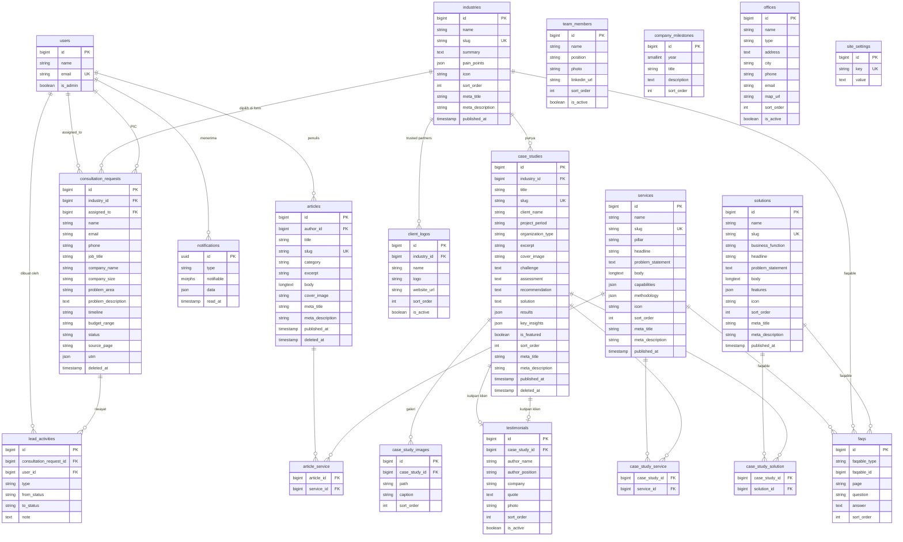

# ERD — Website Konsultan Teknologi

Dokumen ini mendefinisikan struktur database untuk website publik, CMS, dan manajemen lead. Lihat `PRD.md` untuk konteks fitur.

Konvensi:

- Primary key `id` (bigint, auto increment). Semua tabel memiliki `created_at` dan `updated_at`.
- Slug unik untuk entitas yang tampil di URL publik.
- Konten publik memakai `published_at` (null berarti draft) dan `sort_order` untuk urutan tampil.
- Soft delete (`deleted_at`) hanya untuk `case_studies`, `articles`, dan `consultation_requests`, karena data ini bernilai historis.
- Kolom JSON dipakai untuk daftar sederhana yang tidak perlu di-query (deliverable, metrik hasil).

## 1. Diagram

## 2. Detail Tabel

### `users` (sudah ada, ditambah satu kolom)

| Kolom      | Tipe                     | Null  | Keterangan                                     |
| ---------- | ------------------------ | ----- | ---------------------------------------------- |
| `is_admin` | boolean, default `false` | tidak | Akses panel `/admin` lewat Gate `access-admin` |

### `industries`

| Kolom                            | Tipe                    | Null  | Keterangan                               |
| -------------------------------- | ----------------------- | ----- | ---------------------------------------- |
| `name`                           | string(100)             | tidak | Contoh: Manufaktur                       |
| `slug`                           | string(120), unique     | tidak |                                          |
| `summary`                        | text                    | ya    | Ringkasan untuk kartu                    |
| `pain_points`                    | json                    | ya    | Daftar masalah umum, array of string     |
| `icon`                           | string(50)              | ya    | Nama ikon dari daftar ikon yang didukung |
| `sort_order`                     | unsigned int, default 0 | tidak |                                          |
| `meta_title`, `meta_description` | string(70), string(160) | ya    | SEO                                      |
| `published_at`                   | timestamp, index        | ya    | Null berarti draft                       |

### `services`

| Kolom                            | Tipe                    | Null  | Keterangan                                                                      |
| -------------------------------- | ----------------------- | ----- | ------------------------------------------------------------------------------- |
| `name`                           | string(150)             | tidak |                                                                                 |
| `slug`                           | string(170), unique     | tidak |                                                                                 |
| `pillar`                         | string(30), index       | tidak | Enum `ServicePillar`: `consulting`, `design`, `development`, `support`          |
| `headline`                       | string(200)             | ya    | Kalimat masalah yang diselesaikan                                               |
| `problem_statement`              | text                    | ya    |                                                                                 |
| `body`                           | longtext                | ya    | Konten detail                                                                   |
| `capabilities`                   | json                    | ya    | Sub-layanan `[{title, description}]`, maksimal 12 (menggantikan `deliverables`) |
| `methodology`                    | json                    | ya    | Tahapan kerja `[{title, description}]`, maksimal 10                             |
| `meta_title`, `meta_description` | string(70), string(160) | ya    | SEO                                                                             |
| `icon`                           | string(50)              | ya    |                                                                                 |
| `sort_order`                     | unsigned int            | tidak |                                                                                 |
| `published_at`                   | timestamp, index        | ya    |                                                                                 |

### `solutions`

| Kolom                                                | Tipe                | Null  | Keterangan                                                                                            |
| ---------------------------------------------------- | ------------------- | ----- | ----------------------------------------------------------------------------------------------------- |
| `name`                                               | string(150)         | tidak |                                                                                                       |
| `slug`                                               | string(170), unique | tidak |                                                                                                       |
| `business_function`                                  | string(30), index   | tidak | Enum `BusinessFunction`: `operations`, `sales`, `finance`, `human_resource`, `information_technology` |
| `problem_statement`                                  | text                | ya    |                                                                                                       |
| `body`                                               | longtext            | ya    |                                                                                                       |
| `features`                                           | json                | ya    | Fitur `[{title, description}]`, maksimal 12                                                           |
| `headline`, `icon`, `meta_title`, `meta_description` | string              | ya    | Sama seperti `services`                                                                               |
| `sort_order`                                         | unsigned int        | tidak |                                                                                                       |
| `published_at`                                       | timestamp, index    | ya    |                                                                                                       |

### `case_studies`

| Kolom                            | Tipe                              | Null  | Keterangan                                                           |
| -------------------------------- | --------------------------------- | ----- | -------------------------------------------------------------------- |
| `industry_id`                    | FK → `industries`, `nullOnDelete` | ya    |                                                                      |
| `title`                          | string(200)                       | tidak |                                                                      |
| `slug`                           | string(220), unique               | tidak |                                                                      |
| `client_name`                    | string(150)                       | tidak | Bisa disamarkan, misal "Perusahaan Distribusi FMCG"                  |
| `project_period`                 | string(50)                        | ya    | Contoh: "2025 - Sekarang"                                            |
| `organization_type`              | string(30)                        | ya    | Enum `OrganizationType`                                              |
| `excerpt`                        | string(300)                       | ya    |                                                                      |
| `cover_image`                    | string                            | ya    | Path di disk `public`                                                |
| `challenge`                      | text                              | tidak | Tahap: Tantangan                                                     |
| `assessment`                     | text                              | ya    | Tahap: Temuan assessment                                             |
| `recommendation`                 | text                              | ya    | Tahap: Rekomendasi                                                   |
| `solution`                       | text                              | tidak | Tahap: Solusi                                                        |
| `results`                        | json                              | ya    | `[{label, value}]`, contoh `{"label":"Waktu proses","value":"-60%"}` |
| `key_insights`                   | json                              | ya    | Insight untuk pimpinan `[{title, description}]`, maksimal 6          |
| `meta_title`, `meta_description` | string(70), string(160)           | ya    | SEO                                                                  |
| `is_featured`                    | boolean, default false            | tidak | Tampil di Beranda                                                    |
| `sort_order`                     | unsigned int                      | tidak |                                                                      |
| `published_at`                   | timestamp, index                  | ya    |                                                                      |
| `deleted_at`                     | timestamp                         | ya    | Soft delete                                                          |

### `case_study_images`

Galeri studi kasus. `case_study_id` FK `cascadeOnDelete`, `path` di disk `public` (`case-studies/gallery`), `caption` opsional, `sort_order`. Gambar baru ditambahkan di urutan terakhir.

### `case_study_service` dan `case_study_solution` (pivot)

Primary key gabungan (`case_study_id`, `service_id` / `solution_id`). Kedua FK memakai `cascadeOnDelete`.

### `articles`

| Kolom              | Tipe                         | Null  | Keterangan             |
| ------------------ | ---------------------------- | ----- | ---------------------- |
| `author_id`        | FK → `users`, `nullOnDelete` | ya    |                        |
| `title`            | string(200)                  | tidak |                        |
| `slug`             | string(220), unique          | tidak |                        |
| `category`         | string(50), index            | ya    |                        |
| `excerpt`          | string(300)                  | ya    |                        |
| `body`             | longtext                     | tidak |                        |
| `cover_image`      | string                       | ya    |                        |
| `meta_title`       | string(70)                   | ya    | Default dari `title`   |
| `meta_description` | string(160)                  | ya    | Default dari `excerpt` |
| `published_at`     | timestamp, index             | ya    |                        |
| `deleted_at`       | timestamp                    | ya    |                        |

### `article_service` (pivot)

Artikel insight terkait layanan, tampil di halaman detail layanan. Primary key gabungan, kedua FK `cascadeOnDelete`.

### `company_milestones`

Timeline perjalanan perusahaan (halaman Tentang). Kolom: `year` (unsigned smallint), `title` (string 150), `description` (text, opsional), `sort_order` (urutan dalam tahun yang sama). Index (`year`, `sort_order`).

### `offices`

Kantor pusat dan cabang (halaman Kontak). Kolom: `name`, `type` (enum `OfficeType`), `address`, `city`, `phone`, `email`, `map_url` (link Google Maps), `sort_order`, `is_active`.

### `site_settings`

Pengaturan website key/value yang diubah dari menu **Pengaturan Website** (4 tab). Nilai kosong memakai default dari config bila ada. Di-cache dan otomatis dibersihkan saat disimpan.

| Tab             | Key                                                                                                                |
| --------------- | ------------------------------------------------------------------------------------------------------------------ |
| Umum            | `site_name` (default `app.name`), `tagline`, `footer_text`, `site_logo`_, `site_favicon`_                          |
| Kontak & Lokasi | `contact_email`, `contact_phone`, `contact_whatsapp`, `contact_address`, `business_hours`, `maps_embed_url`        |
| Media Sosial    | `social_linkedin`, `social_instagram`, `social_youtube`, `social_facebook`, `social_x`, `social_tiktok`            |
| SEO             | `seo_title`, `seo_description`, `seo_keywords`, `seo_og_image`*, `google_analytics_id`, `google_site_verification` |

\* Path file di disk `public` (folder `settings`).

### `notifications`

Tabel bawaan Laravel untuk notifikasi database. Dipakai untuk notifikasi "lead baru" ke semua admin (lonceng di topbar).

### `faqs`

| Kolom                        | Tipe              | Null  | Keterangan                                                       |
| ---------------------------- | ----------------- | ----- | ---------------------------------------------------------------- |
| `faqable_type`, `faqable_id` | morphs, nullable  | ya    | Untuk FAQ milik Layanan/Industri/Solusi                          |
| `page`                       | string(50), index | ya    | Untuk FAQ halaman statis: `how-we-work`, `about`, `consultation` |
| `is_active`                  | boolean           | tidak | Tampil atau tidak                                                |
| `question`                   | string(255)       | tidak |                                                                  |
| `answer`                     | text              | tidak |                                                                  |
| `sort_order`                 | unsigned int      | tidak |                                                                  |

`faqable_type` memakai alias morph `service`, `industry`, `solution` (didaftarkan di `AppServiceProvider`).

### `team_members`, `testimonials`, `client_logos`

Kolom mengikuti diagram. Semuanya memiliki `sort_order` dan `is_active`. `testimonials.case_study_id` bersifat opsional (`nullOnDelete`). `client_logos.industry_id` opsional (`nullOnDelete`) untuk menampilkan "Trusted Partners" per industri; file logo disimpan di disk `public` (`client-logos`).

### `consultation_requests`

| Kolom                 | Tipe                              | Null  | Keterangan                                                              |
| --------------------- | --------------------------------- | ----- | ----------------------------------------------------------------------- |
| `industry_id`         | FK → `industries`, `nullOnDelete` | ya    |                                                                         |
| `assigned_to`         | FK → `users`, `nullOnDelete`      | ya    | PIC follow-up                                                           |
| `name`                | string(100)                       | tidak |                                                                         |
| `email`               | string(150), index                | tidak |                                                                         |
| `phone`               | string(30)                        | tidak |                                                                         |
| `job_title`           | string(100)                       | ya    |                                                                         |
| `company_name`        | string(150)                       | tidak |                                                                         |
| `company_size`        | string(20)                        | ya    | Enum `CompanySize`: `1-10`, `11-50`, `51-200`, `201-1000`, `1000+`      |
| `problem_area`        | string(30)                        | tidak | Enum `BusinessFunction` (sama dengan `solutions`) ditambah `other`      |
| `problem_description` | text                              | tidak |                                                                         |
| `timeline`            | string(20)                        | ya    | Enum `ProjectTimeline`: `asap`, `1-3_months`, `3-6_months`, `exploring` |
| `budget_range`        | string(20)                        | ya    | Enum `BudgetRange`                                                      |
| `status`              | string(20), index, default `new`  | tidak | Enum `LeadStatus`                                                       |
| `source_page`         | string(255)                       | ya    | URL asal                                                                |
| `utm`                 | json                              | ya    | `{source, medium, campaign, term, content}`                             |
| `deleted_at`          | timestamp                         | ya    |                                                                         |

Index gabungan: (`status`, `created_at`) untuk list admin.

### `lead_activities`

| Kolom                      | Tipe                         | Null  | Keterangan                                                               |
| -------------------------- | ---------------------------- | ----- | ------------------------------------------------------------------------ |
| `consultation_request_id`  | FK, `cascadeOnDelete`        | tidak |                                                                          |
| `user_id`                  | FK → `users`, `nullOnDelete` | ya    | Null untuk aktivitas sistem (lead dibuat)                                |
| `type`                     | string(20)                   | tidak | Enum `LeadActivityType`: `created`, `status_changed`, `assigned`, `note` |
| `from_status`, `to_status` | string(20)                   | ya    | Diisi saat `status_changed`                                              |
| `note`                     | text                         | ya    |                                                                          |

## 3. Enum (PHP backed enum di `app/Enums`)

| Enum               | Nilai                                                                                                                       |
| ------------------ | --------------------------------------------------------------------------------------------------------------------------- |
| `LeadStatus`       | `New`=`new`, `DiscoveryCall`=`discovery_call`, `Assessment`=`assessment`, `Proposal`=`proposal`, `Won`=`won`, `Lost`=`lost` |
| `ServicePillar`    | `Consulting`, `Design`, `Development`, `Support`                                                                            |
| `BusinessFunction` | `Operations`, `Sales`, `Finance`, `HumanResource`, `InformationTechnology`, `Other`                                         |
| `CompanySize`      | `Micro`=`1-10`, `Small`=`11-50`, `Medium`=`51-200`, `Large`=`201-1000`, `Enterprise`=`1000+`                                |
| `ProjectTimeline`  | `Asap`, `OneToThreeMonths`, `ThreeToSixMonths`, `Exploring`                                                                 |
| `BudgetRange`      | `Under50m`, `From50mTo150m`, `From150mTo500m`, `Above500m`, `NotSure`                                                       |
| `LeadActivityType` | `Created`, `StatusChanged`, `Assigned`, `Note`                                                                              |
| `OrganizationType` | `Corporate`, `Sme`, `Government`, `StateOwned`, `NonProfit`, `Education`                                                    |
| `OfficeType`       | `Head`=`head`, `Branch`=`branch`                                                                                            |

Setiap enum memiliki method `label(): string` untuk teks bahasa Indonesia di UI.

## 4. Aturan Relasi (Eloquent)

- `Industry` hasMany `CaseStudy`, hasMany `ConsultationRequest`, hasMany `ClientLogo`, morphMany `Faq`.
- `Service` belongsToMany `CaseStudy`, belongsToMany `Article`, morphMany `Faq`.
- `Solution` belongsToMany `CaseStudy`, morphMany `Faq`.
- `CaseStudy` belongsTo `Industry`, belongsToMany `Service` dan `Solution`, hasMany `CaseStudyImage`, hasOne `Testimonial`.
- `ConsultationRequest` belongsTo `Industry`, belongsTo `User` (sebagai `assignee`), hasMany `LeadActivity`.
- `LeadActivity` belongsTo `ConsultationRequest`, belongsTo `User`.
- `Article` belongsTo `User` (sebagai `author`), belongsToMany `Service`.
- `ClientLogo` belongsTo `Industry`.
- `Faq` morphTo `faqable` (`Service`, `Industry`, `Solution`).
- `Testimonial` belongsTo `CaseStudy`.
- `User` hasMany `ConsultationRequest` (sebagai `assignedLeads`).
- Scope `published()` di model konten: `whereNotNull('published_at')->where('published_at', '<=', now())`.

## 5. Perbandingan dengan suitmedia.com

| suitmedia.com                                                         | Tabel                                                                 |
| --------------------------------------------------------------------- | --------------------------------------------------------------------- |
| Work (studi kasus, periode, tipe organisasi, galeri, insight C-suite) | `case_studies`, `case_study_images`, `case_study_service`             |
| Expertises (pilar, sub-kemampuan, metodologi)                         | `services` (`capabilities`, `methodology`)                            |
| Solutions                                                             | `solutions` (Fase 2)                                                  |
| Industries (value, trusted partners)                                  | `industries`, `client_logos.industry_id`                              |
| Ideas / Insights (terkait expertise)                                  | `articles`, `article_service`                                         |
| About: History, Team, FAQ                                             | `company_milestones`, `team_members`, `faqs`                          |
| Contact (head & branch office)                                        | `consultation_requests`, `offices`                                    |
| Products, Careers, Sustainability                                     | Sengaja tidak dibuat (positioning konsultan, karier tidak dibutuhkan) |
